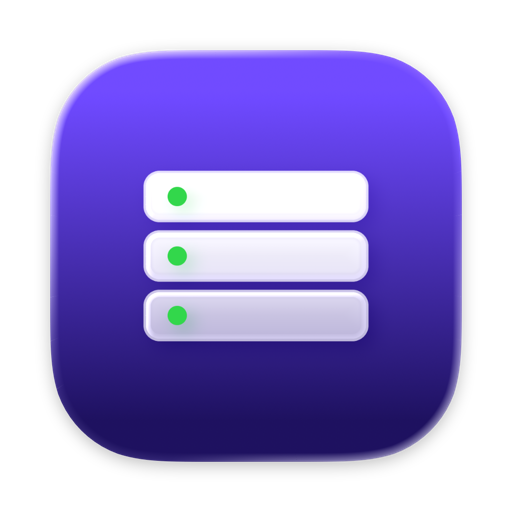
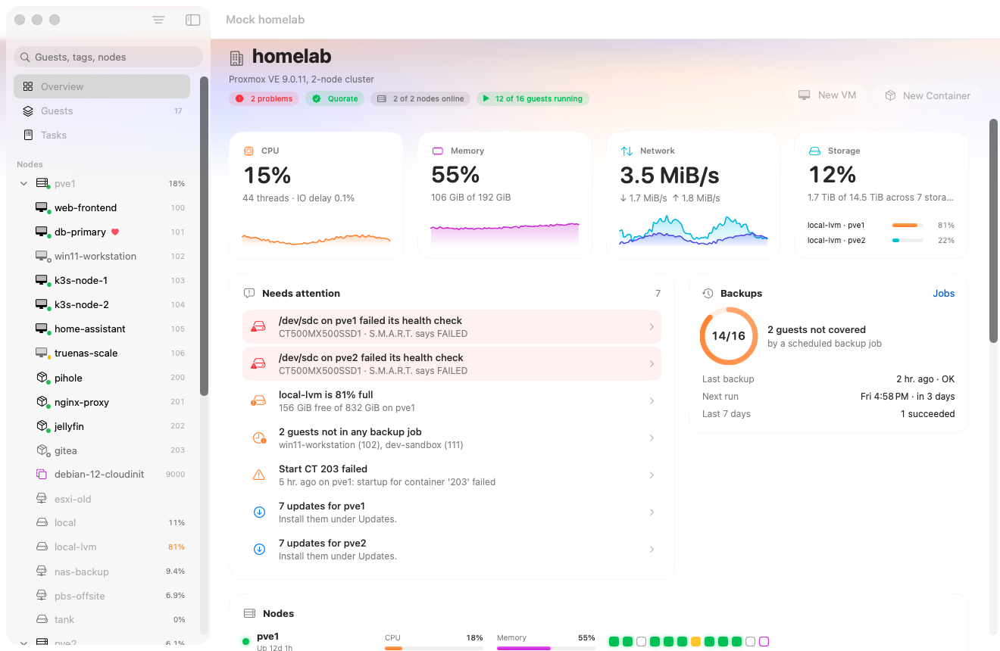
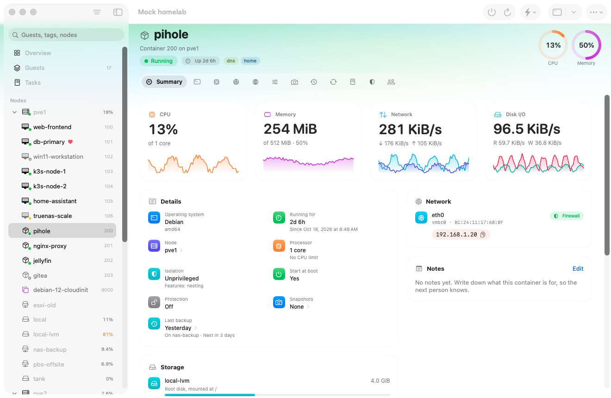
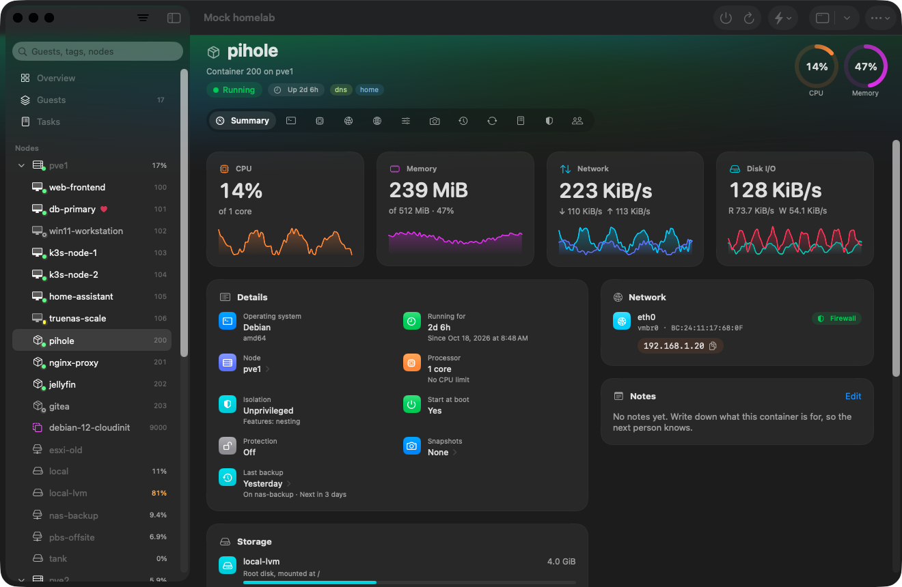

<p align="center">
  
</p>

<h1 align="center">Proxima</h1>

<p align="center">
  A native macOS app for managing <a href="https://www.proxmox.com/en/proxmox-virtual-environment/overview">Proxmox VE</a>, built in SwiftUI for macOS 26's Liquid Glass.
</p>

<p align="center">
  
  
  
</p>



Proxima covers what the Proxmox web interface does (datacenter, nodes, VMs, containers, storage, Ceph, SDN, firewall, users and more) as a real Mac app: a sidebar of your guests, live charts, sheets for every editor, menu bar commands, keyboard shortcuts and a menu bar panel.

## Highlights

- **At a glance.** A live dashboard of cluster load with the last hour, a "Needs attention" list (full storage, failing disks, guests without backups, failed tasks, updates), backup coverage and a rack view with a light per guest.
- **Every guest in detail.** Live CPU, memory, network and disk tiles; the real OS name and kernel, IP addresses and filesystem usage from the guest agent; snapshots, last backup and backup-job coverage; consoles embedded or in their own window.
- **The whole web UI.** Hardware editors that keep settings they don't show, create wizards, clone, migrate with Proxmox's own checks, backups and restores, file-level restore from Proxmox Backup Server, Ceph from install to OSDs, SDN with a preview before Apply, HA, firewall at every level, ACME, notifications and more. [Full list below](#what-it-covers).
- **Safe by design.** Passwords and API token secrets live only in your Keychain, the server's certificate is pinned on first connect, and destructive actions ask first (destroying a guest means typing its ID).

<p>
  
  
</p>

## Requirements

- A Mac with **macOS 26 (Tahoe)** or later.
- A **Proxmox VE 8 or 9** server or cluster. Proxima is developed against Proxmox VE 9.2.
- To build it: **Xcode 26**.

## Install

Proxima is built from source:

```sh
git clone https://github.com/itsmaclol/Proxima.git
cd Proxima
xcodebuild -project Proxima.xcodeproj -scheme Proxima -configuration Release -derivedDataPath .build build
cp -R .build/Build/Products/Release/Proxima.app /Applications/
```

Or open `Proxima.xcodeproj` in Xcode and press ⌘R.

The project signs the app locally (ad hoc), so macOS treats every new build as a new app: after updating, choose **Always Allow** when macOS asks to let Proxima read its saved password, and switch Proxima back on under *System Settings → Privacy & Security → Local Network*. Setting your own team under *Signing & Capabilities* avoids both.

## Connect to your server

1. Choose **Add Server**.
2. Enter the address (for example `192.168.1.10`). You can also paste the web interface's URL; the port is detected.
3. Enter the user, realm and password, or switch to **API Token**.
   - For an OpenID Connect realm (Authentik, Keycloak…), choose the realm and **Continue**: the provider's sign-in page opens in a sheet, and Proxima catches the return to the server. The provider needs the server's address (for example `https://192.168.1.10:8006`) as a redirect URI, as for the web interface.
   - With two-factor on, Proxima asks for a code from your authenticator app, a YubiKey OTP or a recovery key.
   - Accounts that only have a security key (WebAuthn) sign in through the web interface instead. macOS only lets web browsers use security keys with a self-hosted server, so Proxima explains this and offers to open it.
4. On first connect, Proxima shows the server's certificate fingerprint.
   - Compare it with `pve-ssl.pem` in the web interface under *Node → System → Certificates*, then choose **Trust and Connect**.
   - From then on Proxima accepts only that exact certificate, or one macOS already trusts.

**Use a dedicated account.** Prefer a separate user with the role it needs, or an API token, over root. API tokens do everything except open consoles; Proxmox only allows those for password sessions.

**Local Network access.** macOS asks the first time Proxima connects to a server on your LAN. Allow it; if it was denied, Proxima says so and opens the right settings page.

## Security and privacy

- Passwords and API token secrets are stored only in the macOS Keychain, never in files or preferences.
- Certificates are pinned on first use; a changed certificate stops the connection until you check it.
- Consoles and shells use Proxmox's own console page with your session, and close their session on the server as soon as you leave them.
- Proxima talks only to the servers you add. It has no analytics, telemetry or third-party services.

## What it covers

<details>
<summary><b>Datacenter</b></summary>

- **Overview:** live dashboard with cluster health, CPU, memory, network and storage with the last hour, what needs attention, backup coverage, a node "rack" with one light per guest, the busiest guests, recent tasks and storage use.
- **Guests:** a sortable table of every guest with filters; bulk start, shut down, reboot and stop for the selection; and bulk start, shut down, suspend and migrate across the cluster, with a guest picker, timeout, forced stop, target node and parallel jobs.
- **Backups:** jobs (create, edit, enable or disable, run now, see which guests and disks each covers) plus a warning for guests no job covers, and a schedule simulator. Schedule fields offer the web interface's examples.
- **Replication:** jobs (create, run now, enable or disable, delete) with last and next sync.
- **Storage:** add Directory, LVM, LVM-Thin, ZFS, NFS, SMB/CIFS, Proxmox Backup Server, iSCSI or ESXi (to import from) storage, with a Scan button that lists an NFS server's exports, an SMB server's shares, a backup server's datastores, an iSCSI portal's targets or a node's volume groups, thin pools and ZFS pools; edit it, enable or disable it, remove it.
- **Permissions:**
  - access control (ACLs)
  - users (create, edit with expiry date, change password, unlock two-factor, show effective permissions, delete)
  - API tokens (create with expiry date, edit, regenerate the secret, show effective permissions, delete; secrets are shown once)
  - two-factor: add an authenticator app (TOTP, with a QR code), a YubiKey OTP or recovery keys, for yourself or (as root) any user, and enable, disable or remove any entry
  - groups, pools, custom roles
  - realms (LDAP, Active Directory, OpenID Connect: add, edit; sync now with options and a preview; scheduled sync jobs)
- **High Availability:** status, arming and disarming (PVE 9), resources (add, edit, migrate, remove), and node or resource affinity rules (PVE 9) or groups (PVE 8).
- **Firewall:** rules (add, edit, toggle, reorder, delete; in, out and forward rules where Proxmox allows them; the server's macros and pickers for aliases and IP sets), security groups, aliases and IP sets (also per guest), and the options for each level.
- **SDN:** zones (Simple, VLAN, QinQ, VXLAN, EVPN), VNets, subnets (with DHCP ranges), fabrics (OpenFabric, OSPF), controllers (EVPN, BGP, IS-IS, with route maps), IPAM (NetBox, phpIPAM) and DNS (PowerDNS); each VNet's firewall; the built-in IPAM's addresses; BGP prefix lists and route maps; a preview of what Apply would change on a node, then Apply.
- **Options:** notes (Markdown) and cluster options; cluster members, create or join a cluster; metric servers (InfluxDB, Graphite); notifications (sendmail, SMTP, Gotify, webhook targets and matchers, test send); ACME accounts and DNS plugins; PCI, USB and directory mappings; custom CPU models (PVE 9); subscriptions.
- **Tasks:** the cluster task log, a live log viewer and stopping a running task.

</details>

<details>
<summary><b>Nodes</b></summary>

- **Summary:** status, live charts, notes and the versions of Proxmox's packages.
- **Shell:** in the page, in its own window, or over SPICE in Remote Viewer.
- **System:** DNS, hosts file, time zone, certificates (upload, remove, set the ACME domain, order with ACME), subscription key, wake-on-LAN, system report.
- **Network:** create a bridge, bond or VLAN; edit, delete, apply or revert.
- **SDN:** each zone's state on the node with its VNets and guests; EVPN routes and MAC tables; fabric interfaces, neighbors and routes.
- **Disks:** S.M.A.R.T., initialize with GPT, wipe, and LVM, LVM-Thin, directory and ZFS: create, destroy, ZFS pool details.
- **Services:** start, stop, restart, reload.
- **Updates:** refresh, upgrade in a console, changelogs, repositories.
- **System log:** the live journal, with a filter and follow mode.
- **Ceph:** install it (in a console window), then configure the network and replicas; health, usage, flags, ceph.conf, the configuration database, the CRUSH map and the log; monitors, managers and metadata servers; OSDs (create with DB/WAL disks and encryption, in, out, start, stop, scrub, destroy); pools and CephFS; mute health warnings; rolling restarts; Ceph's own safety check before stopping or destroying a daemon.
- **Also:** firewall and log, task history, permissions, bulk actions for the node's guests, reboot, shut down.

</details>

<details>
<summary><b>Virtual machines and containers</b></summary>

- **Summary:** live CPU, memory, network and disk I/O with the last hour; the OS and kernel, IP addresses and filesystem usage from the guest agent (or the container); uptime, processor, firmware, start at boot, protection, snapshots, last backup and backup-job coverage, HA; network interfaces with addresses you click to copy; disks; Markdown notes; charts.
- **Console:** noVNC for VMs, xterm.js for containers; embedded or in its own window. SPICE opens in Remote Viewer if it's installed.
- **VM hardware:** every device, with editors for memory and ballooning, processors with CPU flags, BIOS, display, machine (with a pinned version and vIOMMU) and SCSI controller (editing keeps the settings an editor doesn't show); disks (add, change options, resize, move storage, detach, delete); CD/DVD media and network devices; EFI disk, TPM, and USB or PCI passthrough (with mediated device types for vGPUs); shared folders (virtiofs); serial, audio, VirtIO RNG and Cloud-Init drives; raw values for anything else. Pending changes are flagged and can be reverted.
- **Cloud-Init:** user, password, SSH keys, DNS, IP configuration, custom files, regenerate the image.
- **Containers:** resources (memory, swap, CPU, root disk and mount points with resize and move, device passthrough such as `/dev/dri`), network interfaces and DNS.
- **Options:** name, tags, start at boot and order, OS type, boot order (drag to reorder), hotplug, ACPI, KVM, RTC, SMBIOS, guest agent, protection, container features, hookscript.
- **Monitor:** the QEMU monitor of a running VM.
- **Snapshots:** a timeline with take, roll back, edit and delete.
- **Backups:** back up now, restore, notes, protection, view the stored configuration, prune by retention rules with a preview, delete.
- **Power and lifecycle:** start, shut down, reboot, stop, reset, pause, resume, clone (full or linked, to any node), migrate (Proxmox's checks first; live, with local disks), convert to template, destroy.
- **Create:** stepped wizards for new VMs (with or without disks and network) and containers.
- **Also:** replication, tasks, firewall and permissions per guest.

</details>

<details>
<summary><b>Storage</b></summary>

- Usage over time, and a tab per content type:
  - **Backups:** restore to a new or existing guest; on Proxmox Backup Server, browse a backup and download single files or folders.
  - **ISO images:** upload from the Mac with progress (Proxima sends the file's SHA-256 so Proxmox rejects a damaged transfer), or download straight to the server from a URL.
  - **Container templates:** the same, plus the Proxmox template catalog and pulling OCI images (Docker Hub or any registry) for application containers.
  - **Disk images:** list, with orphaned images marked.
  - **Import:** upload OVA/OVF appliances; import them, or a guest on an ESXi host, as a new VM.
  - **Snippets:** list. Proxmox doesn't accept snippet uploads over its API; copy them to the node over SSH.
- Permissions.

</details>

<details>
<summary><b>Mac extras</b></summary>

- A menu bar panel with cluster load and one-click start or shut down for every guest.
- **Guest** and **Node** menus with every action for what's selected in the sidebar.
- Keyboard shortcuts: ⌘R refresh, ⌘N new VM, ⇧⌘N new container, ⌘1–3 Overview, Guests, Tasks.
- Search the sidebar by name, ID, tag or node, and group it by node, type, tag or pool.
- Light and dark mode.

</details>

**Web interface only:** security keys (WebAuthn and U2F), for signing in and for adding a key. macOS only lets web browsers use security keys with a self-hosted server, so Proxima opens the web interface for these. Keys added there can be listed, disabled and removed in Proxima.

## Development

```
Proxima/          the app (SwiftUI, Swift 6, main-actor by default)
  API/            Proxmox API client, models, Keychain, certificate trust
  State/          app and session state
  UI/             one folder per area: Datacenter, Node, Guest, Storage, Admin, Console, Login…
ProximaTests/     Swift Testing unit tests, plus live checks against a real server
MockPVE/          a stateful fake Proxmox API for development
Tools/            checks against a real server's API (no sign-in needed)
```

Run the tests with ⌘U in Xcode, or:

```sh
xcodebuild test -project Proxima.xcodeproj -scheme Proxima -destination 'platform=macOS'
```

### Fake server

`MockPVE/mock_pve.py` imitates the Proxmox API on `https://127.0.0.1:8006`, with a self-signed certificate, tickets, CSRF, API tokens, TOTP and an OpenID realm. It keeps state: guests, tasks, snapshots, backups, users and firewall rules all change as you use the app. It creates its certificate and test logins (`MockPVE/seed-users.json`) on first run.

```sh
python3 MockPVE/mock_pve.py                          # a two-node homelab with Ceph
MOCK_PVE_PROFILE=stress python3 MockPVE/mock_pve.py  # 140 guests, long names, an offline node, Ceph not installed
MOCK_PVE_STANDALONE=1 python3 MockPVE/mock_pve.py    # not in a cluster yet, to try create and join
```

<details>
<summary>Debug-only environment variables (left out of Release builds)</summary>

- `PROXIMA_DEBUG_SECRET` signs in to `127.0.0.1` without typing.
- `PROXIMA_DEBUG_PLACE` opens a page, for example `guest:100`, `node:pve1` or `options`.
- `PROXIMA_DEBUG_TAB` opens a tab on that page, for example `hardware` or `notifications`.
- `PROXIMA_DEBUG_SHEET` opens a guest sheet, for example `createVM`, `clone:9000` or `migrate:100`, or a bulk action: `bulk:start`, `bulk:shutdown:pve1`.
- `PROXIMA_DEBUG_ACTION` opens a form, for example `add-pci`, `edit-processors`, `edit-machine`, `add-ha-rule`, `join-cluster`, `create-osd`, `restore-files`, `restore-download`, `edit-tfa`, `import-guest`, `pull-oci`, `add-nfs`, `add-lvmthin`, `schedule-simulator`, `register-acme`, `edit-zone`, `sdn-firewall`, `sdn-ipam` or `sdn-review`.
- `PROXIMA_DEBUG_STEP` opens a create wizard on that step (with `PROXIMA_DEBUG_SHEET=createVM` or `createCT`).
- `PROXIMA_DEBUG_APPEARANCE` set to `light` or `dark` overrides the system appearance for the app.
- `PROXIMA_DEBUG_CONSOLE_DUMP` set to a folder saves what an embedded console renders, as PNG and text.
- `PROXIMA_DEBUG_NAV` set to a file moves the running app whenever the file changes. The file holds `<place> [tab]`, as for `PROXIMA_DEBUG_PLACE`, or `appearance light|dark`.
- `PROXIMA_DEBUG_TFA` set to methods (for example `webauthn` or `totp,recovery`) opens the second-factor step of sign-in, when no server is saved yet. `PROXIMA_DEBUG_ADDRESS` fills in the address.

</details>

### Checks against a real server

These need no sign-in.

`Tools/livecheck.sh` builds Proxima's own networking code into a small command-line check: that the self-signed certificate is caught and matches OpenSSL's fingerprint, that pinning it lets requests through (and a wrong pin doesn't), that realms load, that the server answers 401 without a session, and that error messages decode.

`Tools/apicheck.sh` checks every API call Proxima makes against that server's own API schema (the file behind the web interface's API viewer): that each path exists, takes that method and accepts the parameter names sent.

```sh
Tools/livecheck.sh 192.168.1.10
Tools/apicheck.sh 192.168.1.10
```

The same checks run as tests inside the app once Proxima is allowed in *Local Network* settings:

```sh
TEST_RUNNER_PROXIMA_LIVE_HOST=192.168.1.10 xcodebuild test -project Proxima.xcodeproj -scheme Proxima -only-testing:ProximaTests/LiveServer
```

## Disclaimer

Proxima is an independent project. It is not affiliated with, endorsed by or supported by Proxmox Server Solutions GmbH. Proxmox® is a registered trademark of Proxmox Server Solutions GmbH.
